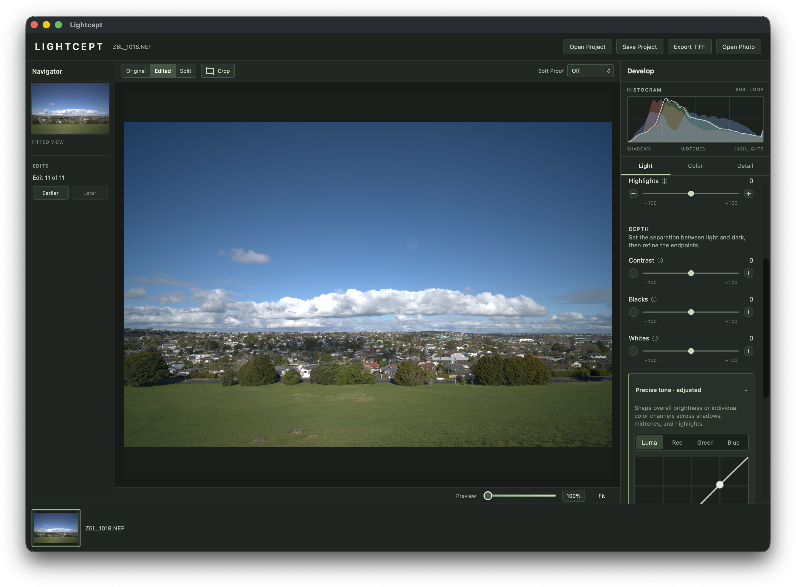

<p align="center">
  
</p>

# Lightcept

Lightcept is a native RAW photo editor for macOS. Its current workflow uses
manual, non-destructive controls. Editing from photographic intent is a longer
term goal.

The app is an early preview. It opens a bounded set of qualified RAW sources,
renders native previews, applies tonal and color edits, saves and reopens
versioned project recipes, and exports 16-bit TIFF through a headless Cyna
engine.

## Editor preview



The manual editor groups controls by photographic purpose. Light shapes
brightness and contrast; Color offers overall color, selection by photograph
or color group, and creative grading; Detail adjusts clarity and texture.
Changes update the native preview, and the edit history supports earlier and
later states. The photograph strip currently shows the open photo and leaves
room for future library or culling workflows.

## Highlights

- **Source-safe by design.** Decode, preview, edit, and export never rewrite the
  original RAW file. Projects pin the source identity and render provenance.
- **Bounded manual edits.** Controls submit validated, bounded operations to
  the native preview pipeline.
- **Headless imaging engine.** The Cyna engine is usable without the desktop
  app and owns the pixel mathematics for each stage.
- **Native desktop shell.** Neiv hosts the app; Weiv renders the page; Cyna owns
  commands, document state, and native preview publication.
- **Honest support scope.** A qualified source variant is backed by reproducible
  evidence. Other variants fail closed instead of silently degrading.

## Requirements

- macOS 15 or later, with Xcode Command Line Tools
- Node.js 22
- Cyna 0.5.0, installed from [cyna.dev](https://cyna.dev/)
- A Neiv checkout at `../neiv`, or set `LIGHTCEPT_NEIV_CLI` to its `neiv.mjs`

The standard setup links the installed Cyna compiler into the project toolchain
path. Reproducing the pinned compiler from source requires Zig 0.17.0 and source
access to Cyna and `zig-libs` if those repositories are private.

## Build and run

```sh
scripts/setup-installed-cyna.sh
ui/neiv/build.sh
open ui/neiv/build/NeivApp.app
```

The Neiv app bundle is written to `ui/neiv/build/NeivApp.app`. It includes
the Lightcept icon, the sRGB profile, and the headless TIFF and preview workers.
The preview host currently builds with Cyna's `debug` profile because the
pinned compiler's `release` optimization of the Neiv app module is impractically
slow; the headless engine and worker tools build as release artifacts.

## Verify

```sh
scripts/check-boundaries.sh
target/cyna-toolchain/cyna/zig-out/bin/cyna fmt src --check
target/cyna-toolchain/cyna/zig-out/bin/cyna check .
python3 scripts/test-cyna-native.py
```

The boundary check enforces the Cyna engine's import ownership and keeps Rust
out of the active source tree. Native tests exercise the engine directly.

## Supported input

The current desktop slice opens:

- Ricoh GR III and GR IIIx DNG captures on the qualified native route
- Nikon Z8 lossless and Z6 II packed 14-bit NEF layouts on the experimental
  native route, including as-shot gain, clipped-neutral highlight
  reconstruction, and oriented preview/export

Other cameras, compression variants, and DNG layouts are not implied by a
decoder accepting a file. Exact source identities and evidence scope are
recorded in the private `neucine/daydream` engineering repository under
`projects/lightcept/qualification/`.

## Repository layout

- `cyna.toml` — headless Cyna package manifest
- `src/engine` — RAW decode, color, develop, render, and pipeline components
- `ui/neiv` — Neiv desktop app, Weiv page, and native preview provider
- `src/tools` — headless worker and qualification entry points
- `scripts` — toolchain, boundary, and qualification helpers
- `assets` — app icon, fonts, and attribution
- `docs` — public documentation; internal engineering records live in the
  private `neucine/daydream` repository under `projects/lightcept/`

The earlier Rust application, Cargo workspace, and Rust qualification tools are
preserved in the sibling `lightcept-rust-reference` checkout. They are not part
of this repository and are not built here.

## Documentation

- [Documentation guide](docs/README.md)
- [Terminology](docs/terminology.md)
- [Quiet Studio UX](docs/product/quiet-studio-ux.md)

Architecture and qualification records are available to project contributors
in the private `neucine/daydream` repository.

## Contributing

See [CONTRIBUTING.md](CONTRIBUTING.md) for the development workflow and required
checks. Keep source photographs immutable and add qualification evidence for any
new source variant or processing stage.

## License

Lightcept is available under the Mozilla Public License, version 2.0. See
[LICENSE](LICENSE) and [NOTICE](NOTICE) for third-party attribution.
