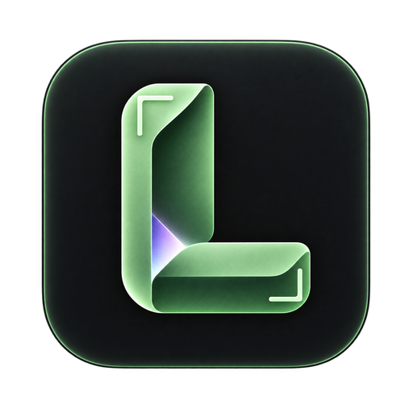

<p align="center">
  
</p>

# Lightcept

Lightcept is a native RAW photo editor for macOS. Its current workflow uses
manual, non-destructive controls. Editing from photographic intent is a longer
term goal.

The app is an early preview. It opens a bounded set of qualified RAW sources,
renders native previews, applies tonal and color edits, saves and reopens
versioned project recipes, and exports 16-bit TIFF through a headless Cyna
engine.

## Editor preview


The manual editor groups controls by photographic purpose. Light shapes
brightness and contrast; Color offers overall color, selection by photograph
or color group, and creative grading; Detail adjusts clarity and texture.
Changes update the native preview, and the edit history supports earlier and
later states. The photograph strip currently shows the open photo and leaves
room for future library or culling workflows.

## Requirements

- macOS 26 or later to build with the current Cyna toolchain, with Xcode
  Command Line Tools; the application targets macOS 15 or later
- Node.js 22
- Cyna 0.5.3, installed from [cyna.dev](https://cyna.dev/)
- Z3 4.15.4 at `/opt/homebrew/opt/z3/lib/libz3.4.15.dylib`, required by the
  Cyna 0.5.3 macOS LLVM tools
- A Neiv checkout at `../neiv` with dependencies installed using
  `npm ci --prefix ../neiv/packages/neiv`, or set `LIGHTCEPT_NEIV_CLI` to its
  `neiv.mjs`

The standard setup links the installed Cyna compiler into the project toolchain
path. See [Contributing](CONTRIBUTING.md) for source builds and checks.

## Build and run

```sh
scripts/setup-installed-cyna.sh
ui/neiv/build.sh
open ui/neiv/build/NeivApp.app
```

The app bundle is written to `ui/neiv/build/NeivApp.app`.

## Supported input

The current desktop slice opens:

- Ricoh GR III and GR IIIx DNG captures on the qualified native route
- Nikon Z8 lossless and Z6 II packed 14-bit NEF layouts on the experimental
  native route, including as-shot gain, clipped-neutral highlight
  reconstruction, and oriented preview/export

Other cameras, compression variants, and DNG layouts may fail to open. The app
does not silently substitute an embedded preview for an unsupported RAW image.

## Documentation

- [Documentation guide](docs/README.md)
- [Terminology](docs/terminology.md)
- [Contributing](CONTRIBUTING.md)

## License

Lightcept is available under the Mozilla Public License, version 2.0. See
[LICENSE](LICENSE) and [NOTICE](NOTICE) for third-party attribution.
